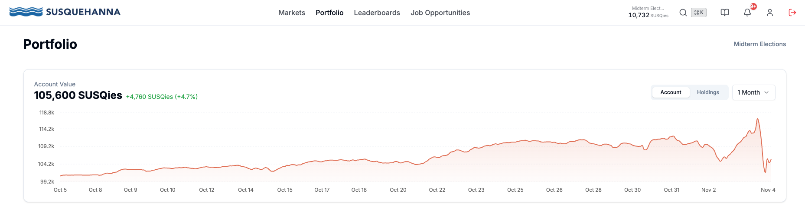
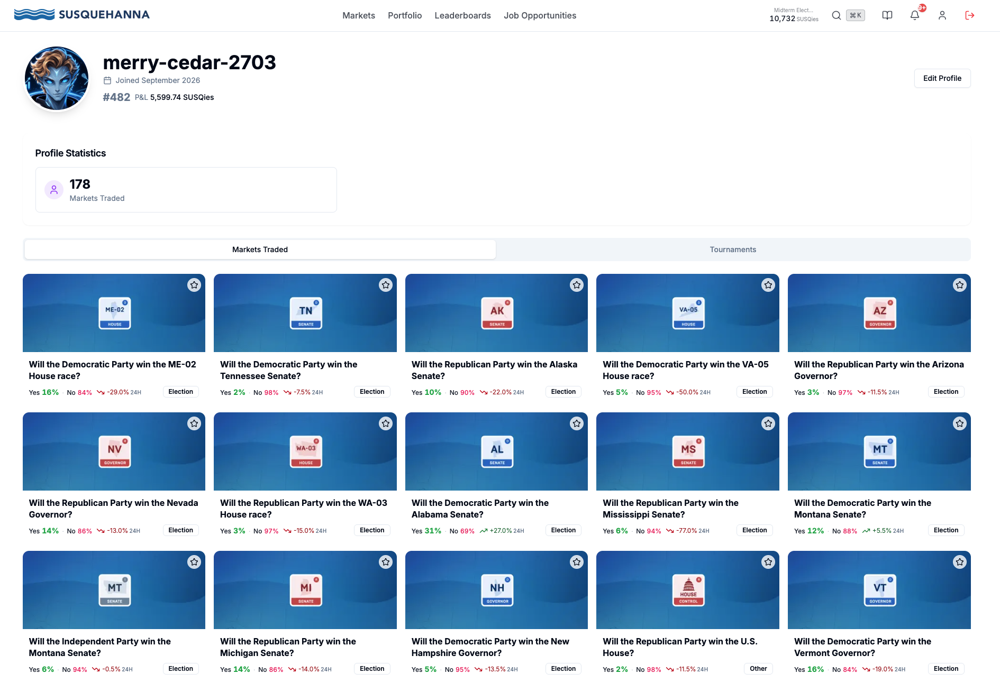

# Shorting the Favorite-Longshot Bias Through a US Midterm Election

An autonomous trading bot built for the **Susquehanna Predictions Cup** — a
34-day simulated-money forecasting tournament on the 2026 US midterms, traded
against ~1,969 other participants for a top-3 cash prize. This repo is the
system that ran it: the statistical edge behind it, 58 commits of honest
iteration, and the final 48 hours of a real election night.

| | |
|---|---|
| **Duration** | Oct 1 – Nov 4, 2026 (34 days) |
| **Field** | 1,969 participants, top 3 paid |
| **Start → lock** | 100,000 → **105,600 SUSQies** (+5.6%, before pending resolutions) |
| **Final rank** | 482 / 1,969 |
| **Code** | ~5,000 lines, 484 tests, 58 commits |

## The idea

The contest runs on its own order book, thinly traded by a few thousand
people. Polymarket runs the same election, in real money, with far more
liquidity and far sharper pricing. When the two disagree, one of them is
almost certainly right — and it's not the thin one.

Measured directly from both venues: **122 of 228 matched markets** priced on
the competition platform above their Polymarket-implied probability, concentrated
in longshot tails. A contract Polymarket priced at 0.7% was sitting at 15% here.
That gap is the classic **favorite-longshot bias** — people overpay for cheap,
exciting longshots — and it's measurable, not assumed.

The strategy: **sell the overpriced tail, hold it to the actual election
result.** Not to the next tick — to November, whatever that means for the
position. Diversified across ~45 independent races so that no single surprise
call can do real damage, and no national swing can either, because every race
is its own coin flip against its own anchor.

## The book

| Strategy | Job |
|---|---|
| **Settlement** | The core book. Shorts tails where price exceeds the Polymarket-implied fair value by a meaningful margin, sized by return-on-collateral, held to resolution. |
| **Pair** | Where it already holds one side of a race, bids for the other side at a price that locks a guaranteed, risk-free profit the moment it fills. |
| **Ladder** | Passive two-sided market-making for the small, fast-decaying microstructure edge — stopped automatically well before election night to avoid holding new directional risk into the close. |
| **Exit** | Harvests ladder inventory before its edge decays (measured: real but gone by 30 minutes), while explicitly protecting settlement positions from being mistaken for stale inventory. |

**One rule governs all of it**: the external anchor is never blended with the
venue's own price. Averaging the two would erase the exact disagreement being
traded. Either Polymarket's number stands alone, or the market doesn't get
touched.

## 58 commits, the honest version

This wasn't built once and left alone. A few of the moments that mattered:

- **A false edge was caught before it shipped.** An early measurement claimed
  +8.75 cents of edge per trade. A rebuild of the markout from timestamped
  fills — not live polling — showed it was **7x overstated**; the real number
  was four tenths of one tick. The commit that fixed it says so directly:
  *"Withdraw the falsified edge claim from strategy docstrings."*
- **A total anchor outage once slipped past every safety rule meant to catch
  it.** One cycle the external feed returned 0 of 228 prices; the code judged
  "not degraded" anyway (an empty result looked identical to "no attempt"),
  and the exit logic started treating a healthy settlement book as decaying
  inventory. Fixed, then stress-tested against the exact failure mode that
  caused it.
- **Budget tuning, done by tracing live data, not guessing.** Three separate
  times, raising the capital allocated to the core book crowded out the other
  strategies almost to zero — each one caught, diagnosed from the actual
  cycle logs, and reverted or rebalanced the same day.
- **The question that mattered most wasn't code.** With a week left, the math
  said reaching the top-3 cash prize required the account to be worth roughly
  **80 times** its current profit — a gap no diversified, statistically-sound
  strategy closes. Getting there would have meant abandoning the measured
  edge for concentrated, undiversified bets — which, modeled honestly, had a
  worse expected outcome than just defending what was already real. That's
  the harder decision to document than any bug fix, and it's the one this
  repo is actually about.

## The last 48 hours

**Nov 2** — prices on dozens of unrelated longshot contracts rose sharply, all
at once, venue-wide. Every tracked peer dropped in step (confirmed: 30 of 30
sampled accounts fell 20–58% in the same hours). Traced it to the trade tape
directly: real, heavy buying volume on exactly the cheap tails this book was
short — other players making the same late, cheap lottery-ticket bets this
system had modeled and declined days earlier. Paper losses, not real ones:
the external anchor barely moved. It mostly reversed within a day.

**Nov 3, election night** — genuine two-way volatility landed right on
schedule at the polls-closing hour. The book traded through it live:
Tennessee and Mississippi Senate alone round-tripped for **+$3,968** combined
in a few hours, fully closed out before the night was over.

**Nov 4** — real results arrived: a larger Democratic wave than priced in,
flipping seven Senate seats. Polymarket's own feed buckled under the
real-money load (confirmed independently by national news coverage of record
volume) — anchor coverage fell from 234 of 237 markets to 53 for **over seven
hours**. The guard built for exactly this held: once coverage drops below
90%, the system freezes its last-known-good protection state rather than
trusting a partial read. It did, without a single manual intervention, while
the account's paper drawdown hit its highest point of the month — and the
kill switch, watching a risk-adjusted number rather than the raw one, never
got within half of its trip threshold.

Trading locked at the scheduled second. Position-by-position math at that
instant: most of the paper loss was set to reverse into real gains once each
race's actual call gets formally applied — Kansas, Oklahoma, Virginia, and
several others were all short positions on the side that had, in fact, lost.

## Where it landed

105,600 SUSQies, rank 482 of 1,969, with several races (Nevada, Alaska,
Oregon governors; Alaska, Mississippi, Nebraska Senate) still uncalled and
expected to resolve favorably on the same thesis over the following days to
weeks — official settlement happens market-by-market, not at the trading
deadline.

## What worked, and what I'd do differently

**Worked:** the edge was real and held up under an actual, confirmed-wave
election — not a backtest. Diversification meant no single surprise call
mattered. The degradation guard, designed from one small October incident,
protected the book through a seven-hour real stress event without anyone
watching it in real time.

**Wouldn't repeat:** capital was the binding constraint for the last third of
the contest — good candidates were priced and ready, with no safe way to fund
them without re-opening a budget split that had already crowded out other
strategies twice. And the strategy was, by design, never a top-3 play: it
optimized for a real, defensible edge over a long shot at a prize that would
have required gambling it away.

---

**Technical reference:** [docs/ARCHITECTURE.md](docs/ARCHITECTURE.md)
**Full trade history:** [data/trade_history.csv](data/trade_history.csv) (9,413 fills, exported via API)
**Tests:** `python -m pytest` — 484 passing
